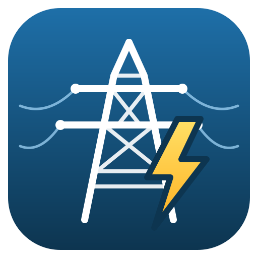

# Rețele Electrice România — integrare Home Assistant (independentă)

Integrare custom, scrisă de la zero, care citește datele locului de consum din portalul
[contulmeu.reteleelectrice.ro](https://contulmeu.reteleelectrice.ro/). Nu folosește cod din alte
integrări și nu are sistem de licență.

## Ce oferă (un dispozitiv per POD)

| Entitate | Descriere |
|---|---|
| Index energie activă | Ultimul index citit (kWh). Merge în Energy dashboard (granularitate lunară). Atribute: data, tipul citirii, istoric pe ~13 luni |
| Data ultimei citiri | Data indexului de mai sus |
| Consum ultima lună citită | Diferența dintre ultimele două citiri reale |
| Întreruperi / Întrerupere activă | Mesajul portalului despre întreruperi + senzor binar |
| Putere aprobată | Diagnostic: putere, adresă, tarif, contract |
| Consum azi / ieri / luna curentă | Doar contor inteligent, din curba de sarcină (kWh) |
| Valori instantanee | Doar contor inteligent: ultimele valori, dacă au fost solicitate din portal |
| Stare contor | Doar contor inteligent: serie, tip, data instalării |

## Instalare

1. Copiază folderul `custom_components/retele_electrice_ro` în `config/custom_components/` din Home Assistant
   (sau adaugă repo-ul în HACS ca *Custom repository → Integration*).
2. Repornește Home Assistant.
3. *Setări → Dispozitive și servicii → Adaugă integrare → „Rețele Electrice România (independent)”*.
4. Introdu emailul și parola de pe portal, apoi alege POD-urile.

Intervalul de actualizare implicit este de 1 oră (minim 15 minute). Datele din curba de sarcină
apar pe portal cu o întârziere de câteva ore, deci „Consum azi” poate rămâne gol dimineața.

Iconița integrării se află în `brand/` și apare automat începând cu Home Assistant 2026.3
(după repornire poate fi nevoie de un refresh forțat în browser).

## Depanare

Activează jurnalul detaliat în `configuration.yaml`:

```yaml
logger:
  logs:
    custom_components.retele_electrice_ro: debug
```

## Limitări

- Portalul nu are API public; integrarea folosește aceleași cereri ca site-ul și se poate strica
  dacă portalul se schimbă.
- Dacă portalul cere verificare suplimentară (cod pe email/SMS), autentificarea automată nu merge.
- Valorile instantanee apar doar după ce apeși „Solicită datele de consum” în portal
  (maxim 10 solicitări / 24 h, procesare până la 2 ore).
